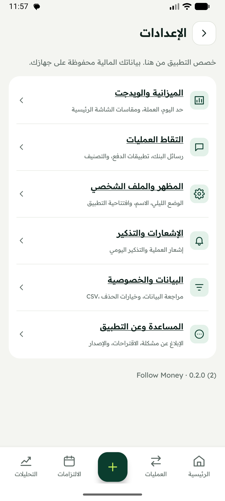

# Follow Money

An Arabic Android app for understanding everyday spending, transfers and recurring payments. Follow Money builds a local financial timeline from supported bank SMS and selected payment notifications, with manual entry and review whenever the source is unclear.

**تتبّع صرفك وتحويلاتك والتزاماتك من مكان واحد، ببيانات محفوظة على جهازك.** [دليل الاستخدام بالعربي](docs/USAGE_AR.md)

| | |
| --- | --- |
| Status | Private project; feature freeze from 14 October 2026 — fixes, testing and Play preparation only |
| App version | 0.2.0 — development build |
| Platform | Android 8.0+ / API 26+ |
| Implementation | Java 17, native Android views, SQLite |
| Services | No backend, account registration or analytics service |

[Current freeze checkpoint and remaining release gates](docs/RELEASE_FREEZE_2026-10-14.md). Existing features are frozen; no new features are planned for this publication cycle. This checkpoint is not a production-readiness or Google Play approval claim.

## What it does

- **Capture:** supported banking SMS, selected payment app notifications, manual transactions and text sharing. Historical SMS import includes a preview before saving.
- **Review:** transactions grouped by date, filters, original source details and account/card identity. A local merchant catalog recognizes known branches and payment-processor prefixes. Save a category correction for future purchases, with a separate preview before applying it to earlier automatic captures.
- **Understand:** a home spending breakdown and focused reports for spending, categories, money flow and recorded living costs, plus links to assets and recurring payments. Report amounts open their underlying transactions; currencies stay separate.
- **Plan:** daily limits, category budgets and confirmed installment/subscription/bill schedules.
- **Finish a task:** reimbursement selection, impact preview, confirmation and undo; related details return to their parent, with search/filter/scroll context retained.
- **Optional points:** whole daily-limit points rounded per day after explicit coverage confirmation; a clear balance/yesterday/today summary and 100-point milestones, with today's result provisional and refunds correcting the original purchase day.
- **Keep it visible:** three home screen widgets plus a compact transparent variant for compatible lock-screen hosts, optional hidden amounts, daily reminders and payment alerts. Lock-screen placement and notification space remain controlled by the host.
- **Get help:** Arabic problem/suggestion drafts sent through your configured email app, with a preview of basic device information. GitHub remains available for developers.

The parser runs locally and uses rules. It does not guarantee recognition of every bank or notification format. Review ambiguous transfers, unclassified expenses and proposed commitments before relying on totals.



Actual emulator capture of the Settings screen; no financial data is shown.

## Reading the numbers

| Number | Meaning |
| --- | --- |
| Everyday spending | Expenses after the applicable refund/reimbursement adjustments; identified commitments are shown separately |
| Commitments | Recorded payments identified as installments, bills or subscriptions; a future schedule alone does not create an expense |
| Transfers to others | Outgoing transfers that are not identified as transfers between your own accounts or as commitments |
| Internal transfers | Movement between your confirmed accounts; not income or consumption |
| Income | Recorded incoming money after applicable refund adjustments; not necessarily salary |
| Daily remaining | Your configured daily limit minus eligible spending today; income does not increase the limit |
| Account balance | Latest explicit bank balance, or an estimate from that anchor and later transactions, labeled accordingly |

These are records captured by the app, not a complete bank statement. Different currencies are never silently added together. [Architecture and calculation boundaries](docs/ARCHITECTURE.md)

## Run locally

Install Android Studio with API 36 support, Java 17 and Android SDK platform 36 / build tools 36.1.0. This project targets API 36 with AGP 8.9.1 and Gradle 8.11.1; use the included wrapper.

```powershell
git clone https://github.com/MohamedGamal-Ahmed/Follow-Money.git
Set-Location Follow-Money
$env:JAVA_HOME = 'C:\Program Files\Android\Android Studio\jbr'
```

Open the project in Android Studio and select your local SDK. Alternatively, create an ignored `local.properties` containing your own `sdk.dir`. Do not copy another developer's machine paths.

```powershell
.\gradlew.bat assembleDebug
```

The debug APK is generated at `app/build/outputs/apk/debug/app-debug.apk`. Upload signing uses local environment variables; no key is included. Use `tools/build-release.ps1 -Unsigned` for local validation or configure an upload key for a signed build. [Google Play preparation and declaration drafts](docs/GOOGLE_PLAY_RELEASE.md). Repository access is required to clone this private project. No Play approval or publication is implied.

## Checks

```powershell
python tools/check-repo.py
# First run / dependencies not yet cached:
.\tools\run-checks.ps1 -Online
# Subsequent runs with dependencies cached:
.\tools\run-checks.ps1
# Additional database/widget/feature checks on a disposable emulator:
.\tools\run-checks.ps1 -Android -Device emulator-5554
```

The script runs the standalone JVM suites, assembles the app and instrumentation APK, and runs Android lint. `-Android` also installs both APKs and runs the three instrumentation groups. Use an emulator with synthetic data: these checks exercise writes and repairs. They are deliberately blocked on physical device IDs.

GitHub Actions uses the same checks for pushes and pull requests to `main`; emulator instrumentation remains a local step. No CI pass or production readiness is implied by the presence of the workflow.

## Project map

```text
app/src/main/java/com/mohamedgamal/masareef/  App, parsing, storage and calculations
app/src/main/res/                           Native layouts, widgets and local assets
app/src/androidTest/                       Android database and feature checks
tools/                                    JVM checks and repository validation
docs/                                     Curated usage, architecture and privacy docs
.github/                                  Issue forms, PR template and CI
```

## Report a problem

Use **الإعدادات ← المساعدة وعن التطبيق ← الإبلاغ عن مشكلة / اقتراح تحسين**. Describe the issue, review the device metadata and open an email draft to **mgamal.ahmed@outlook.com**. Send it yourself from your configured email app. If no email app handles the draft, the address and request are copied to the clipboard. Use invented sample transactions; never include real SMS, databases, account/card numbers or financial exports.

**Application source stays private.** User reports go to the separate [public support repository](https://github.com/MohamedGamal-Ahmed/Follow-Money-Support), which requires GitHub sign-in to submit but no source access or invitation. Reports and attachments are public. The app opens a form in the browser; it does not create an issue automatically. [Reporting and contribution guide](CONTRIBUTING.md)

The `support/` folder is the reviewed, code-free publishing source for the support repository. Its README, forms and guides are copied into a separate checkout; application source and private development docs are never copied there.

## Privacy and ownership

**Monthly summaries:** Analytics retains completed-month reports with currency-separated totals and spending behavior. The home entry disappears after reading. A neutral first-of-month notification can be disabled independently; Android may delay delivery. Percentage comparisons require confirmed coverage and invalidate when the underlying effective records change. [Arabic usage](docs/USAGE_AR.md)

Brand signature: **بكل فخر، صُنع في مصر 🇪🇬** / **Proudly made in Egypt**, with **Developed by Mohamed Gamal** in Settings. Campaigns lead with the product benefit, **اعرف فلوسك راحت فين**, and use **#صنع_في_مصر #FollowMoney**. Use actual app captures with invented demo data for promotional material; the origin signature is a quiet secondary mark.

Financial data stays in app-local storage. Stored source text is encrypted with Android Keystore; the SQLite ledger itself is not encrypted. Android backup is disabled in the app configuration. CSV exports are created only when requested and contain financial data. Support drafts automatically include only app/device/Android/locale information, plus the description you write. [Privacy details](docs/PRIVACY.md)

No open-source license has been granted for this private project's original code. Third-party fonts and brand assets retain their own terms; see [asset attribution](BRAND_ASSETS.md). Commercial redistribution needs an asset-rights review.

[Change log](CHANGELOG.md) · [Security reporting](SECURITY.md) · [GitHub setup](docs/GITHUB_SETUP.md)
