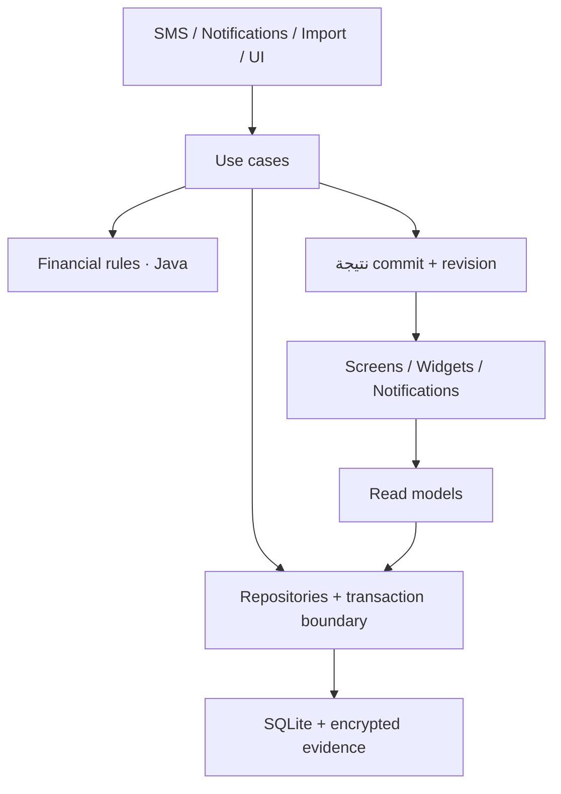

# Follow Money — خطة إصلاح وتفكيك تدريجي

**الحالة:** قيد التنفيذ بدفعات مستقلة ومراجعتَي ChatGPT وClaude وCI قبل الدمج. اعتماد الخطة لا يعني اكتمال مراحلها؛ نتائج كل دفعة وحدودها موثقة في PR الخاص بها. البنود المعلّمة بـ «إضافة Claude» جزء من الخطة المعتمدة.
**التاريخ:** 17 أكتوبر 2026.
**صاحب القرار:** Mohamed Gamal.
**المرجع الأصلي للخطة:** checkout ce35e83؛ MainActivity: 6,265 سطر، ExpenseDb: 2,910، ExpenseParser: 577. هذه أرقام baseline تاريخية وليست قياسات الحالة الحالية.
**النطاق:** موثوقية lifecycle المالي، فصل المسؤوليات، سلامة البيانات، مراجعة الحالات غير المؤكدة واختبارات منع الارتداد.

## السياق والقرار المعماري المقترح

التطبيق Java 17، native Android Views، SQLite، وموديول واحد. المسؤوليات المالية والتخزينية والعرض متداخلة؛ نقل النص بين الملفات وحده لن يفصلها.

نوصي باستخراج تدريجي داخل الستاك الحالي، مع واجهات توافق مؤقتة واختبارات سلوكية. كل دفعة مسؤولة عن رحلة محددة. إصلاح عالي الخطورة يمكن تقديمه بعد اختبار يثبت المشكلة، دون انتظار تفكيك كامل.

| البديل | الفائدة | التكلفة/المخاطرة | القرار المقترح |
| --- | --- | --- | --- |
| إعادة كتابة شاملة أو تغيير Java/Views/SQLite | حرية تصميم كاملة | تغيير UI ومنطق وتخزين معًا يصعّب إثبات حفظ البيانات | مؤجل وخارج الخطة |
| تقسيم MainActivity إلى ملفات UI فقط | مراجعة أسهل جزئيًا | تبقى المعاملات والقواعد المالية متشابكة | جزء من مرحلة الواجهة |
| استخراج use cases وrepositories وشاشات تدريجيًا | تغيير قابل للمراجعة والاختبار مع استمرار التطبيق | واجهات توافق مؤقتة وتتابع نقل منضبط | الموصى به |

لا تحتاج البداية مكتبة جديدة. أي اقتراح لإضافة مكتبة أو scheduler جديد يُذكر باسمه ومبرره قبل تطبيقه. تسميات الكلاسات أدناه مقترحة وتراجع مع conventions عند التنفيذ.

## النتيجة المستهدفة

- MainActivity يستضيف التنقل، الربط مع lifecycle وحالة العودة؛ كل شاشة/رحلة لها مكوّن مستقل.
- ExpenseDb يبقى SQLiteOpenHelper وإنشاء/ترقية schema؛ SQL الخاص بكل مجال ينتقل إلى repository مناسب.
- use case هو مالك transaction للحدث المالي؛ helper تابع لا يفتح transaction متداخلة مبهمة ولا يبتلع فشلها.
- CaptureResult وMutationResult صريحان، بدل boolean وحقول lastCapturedId/lastCaptureEvent القابلة للتغير.
- مسار كتابة مالي متسلسل ومحدد للالتقاط والاستيراد والتعديل والإصلاح؛ لا DB write على UI thread.
- القواعد المالية لا تعتمد على Activity أو NotificationManager.
- العرض والتنبيهات والwidgets تستقبل نتيجة commit وتقرأ نموذج العرض الحالي.
- إعادة إرسال نفس المصدر آمنة؛ إعادة التحليل بعد تحديث parser مسار مستقل بمعاينة وإصدار وسبب.
- نتيجة المرشح المالي تكون محفوظة، مكررًا مثبتًا، تجاهلًا مسببًا، مراجعة قابلة للتصرف، أو فشلًا ظاهرًا له متابعة.

الـdurable inbox يعالج ما استلمه التطبيق وحفظه فعلًا. لا يضمن الوصول لرسالة أو إشعار لم يسلّمه Android، أو التعافي من uninstall أو فقد مفتاح Keystore.

## سجل موحد للمشاكل

المراجع هنا IDs من audit المحادثة ذي 108 عقد. تقرير Claude الأحدث موجود في [fm-lifecycle-audit.md](D:/M.Gamal/Learn/Projects/1/Claude%20outputs/fm-lifecycle-audit.md)، ويتضمن نتائج مشتركة وتصحيحات. ملف Downloads Markdown وحده لا يحتوي بيانات الخريطة.

نربط كل finding باختبار/قرار؛ العدد لا يساوي عدد bugs مستقلة. تصنيفات البداية: مثبت من الكود، سيناريو يحتاج reproduction، قرار منتج، أو استنتاج مصحح/غير قابل للوصول. أي bug لا يغلق إلا بدليل مطابق لنطاقه.

| Work item | المشكلة | Audit IDs | IDs في خريطة Claude | المرحلة |
| --- | --- | --- | --- | --- |
| FM-01 | رسالة غير مفهومة أو خارج preview | E5، E11، P10، R5، R7، R15 | P7b، P7c، D1b | 3 |
| FM-02 | فشل الالتقاط واسترداد العمل | E7، E8 | QX | 3 |
| FM-03 | نتيجة استيراد SMS والمعاملة الداخلية | S10 | I4 | 1 |
| FM-04 | دفعات CSV والتكرار والاستعادة والالتزامات | E16، S23، U16، R18 | V3 | 1,7 |
| FM-05 | حفظ الأدلة والأرصدة وفشل التشفير | S6، S22، U8، U20 | S6، B1 | 3 |
| FM-06 | نتيجة capture صريحة وإعادة المعالجة | S2، E21، S7 | D2b | 2,3 |
| FM-07 | هوية الإشعارات ومتابعة تعديلاتها | U11، U12، R12 | N1a، M2b | 1,5 |
| FM-08 | تحديث الشاشات والـcache | U13، U14، U18 | — | 2,6 |
| FM-09 | قوة قرائن إزالة التكرار | S4، S9 | — | 4 |
| FM-10 | حسم الإلغاء وإتاحة تاريخ الإصلاح | S14، S15 | P5b | 4 |
| FM-11 | ضمان حفظ رسوم التحويل | S21 | — | 1 |
| FM-12 | أثر تعديل الاسترداد ودلالة الميزانية | S19، U17 | — | 4,7 |
| FM-13 | تسوية القسط وربطه وإعادة حسابه | R9، R8، R6، R17، R3، R14 | R9، R0b، R0c، M1 | 5 |
| FM-14 | الغموض المالي والتاريخ والمستقبل | P12، P14، P15، R1 | P3 | 3,4 |
| FM-15 | القرارات المتعلقة بتأكيد الدفع والملكية والديون | C6، R10، R13، R19 | M2a، M3، X1 | 0,5,7 |

عمود «IDs في خريطة Claude» يربط كل بند بمربع في الخريطة التفاعلية؛ لما البند يتقفل، المربع يتحول أخضر في نفس الـ PR. (إضافة Claude)

تغطي الخريطة جميع IDs الـ47 المصنفة OPEN/DECISION في التقرير السابق دون تكرار. بعض القرارات سيغلق بتوثيق سلوك مقصود؛ لا تتحول جميعها تلقائيًا إلى features.

## 0 — baseline وتنقية المراجعة

**المخرجات**
- تشغيل checks الحالية وتسجيل الفشل السابق للتغييرات منفصلًا عن أي regression.
- baseline من fixtures صناعية: counts وIDs والمبالغ/العملة/النوع، الحسابات، الأدلة، الروابط، الرسوم، exclusions، الأرصدة والالتزامات.
- مراجعة كل finding باختبار وصول/فشل. مثل branch قيمة غير موجبة: هل يصل إليه parser التلقائي فعلًا أم guard فقط؟
- اعتماد الدلالات المقترحة أدناه قبل تغيير السلوك المرتبط بها.
- branch محلي عند بدء الكود، وعدم إدخال ملفات agents أو مخرجات المستخدم غير المرتبطة في دفعات التغيير.
- **(إضافة Claude) فجوة الـ CI:** android-ci.yml يشغّل run-checks.ps1 -Online من غير -Android، يعني الـ 17 JVM suite والـ build/lint بس. اختبارات SQLite (ReconciliationTest وUpgradeInstallTest) مش بتشتغل على أي PR. وإصلاحات المرحلة 1 كلها SQLite. **القرار (محمد، 17 أكتوبر): job فيه emulator في الـ CI.** أول دفعة في الخطة بتضيفه، ولحد ما يشتغل مفيش ولا PR يلمس ExpenseDb يتعمله merge. من غير ده، «الاختبارات ناجحة» في الـ PR مش هتثبت حاجة عن مسار الحفظ.
- **(إضافة Claude) تجميد:** طول المرحلتين 1 و2 مفيش أي agent تاني (DeepSeek أو غيره) يفتح PR على ExpenseDb.java أو MainActivity.java أو SmsReceiver.java أو PaymentNotificationListener.java، إلا لو كان جزء من الخطة دي.
- **(إضافة Claude) حسم القرارات:** جدول المرحلة 7 فيه عمود «قرار محمد». أي دفعة بتغيّر سلوك مرتبط بقرار فاضي تقف لحد ما يتملى.
- **(إضافة Claude) مكان الخطة:** الملف يتنقل لـ docs/refactor-plan.md ويتعمله commit في أول دفعة، عشان كل agent يقرا نفس النسخة.

**شرط الخروج:** baseline قابل للإعادة وbacklog موحد مع evidence وexpected outcome. لا تُستبدل نتائج الاختبارات بتقارير نجاح قديمة.

## 1 — تثبيت الحفظ والنتيجة

**تغييرات صغيرة منفصلة**
1. اختبار فشل repair داخل استيراد SMS، ثم إصلاح وصول الفشل إلى مالك transaction؛ لا flags نجاح إلا بعد commit مؤكد.
2. batch CSV atomic مبدئيًا: saved/duplicates/failed مع رسالة عربية واضحة؛ fault عند الصف N لا يترك نصف دفعة ناجحة.
3. فصل التحويل والرسوم في transaction واحدة؛ رفض حفظ fee يمنع نجاح التقسيم الصامت.
4. هوية PendingIntent فريدة لكل كيان وإجراء، مع اختبار عمليتين متتاليتين؛ إجراء «دفعته» يعالج نتيجة no-op/failure.

**شرط الخروج:** اختبارات فشل مقصودة تثبت صفر نجاح كاذب وصفر تغيّر مالي جزئي في هذه الرحلات. التنفيذ لا يغيّر parser أو شكل الشاشات في نفس الدفعة.

## 2 — استخراج حدود التطبيق والتخزين

**التدرج**
- تقديم CaptureRequest/CaptureResult وMutationResult أولًا. النتيجة تصف transaction IDs، evidence outcome، dbChanged، needsReview، وسبب التوقف.
- استخراج CaptureTransaction/ImportBatch/TransactionMutation كرحلات، مع ExpenseDb facade مؤقتة حتى تنتقل call sites.
- استخراج repositories حسب المسؤولية: transactions/evidence، accounts/balances، commitments، reimbursement/card settlement؛ لا نخلق repository لكل table بلا حاجة.
- نقل ownership للـDB والworker إلى نطاق التطبيق؛ Activity لا تغلق موردًا ما زالت عملية خلفية تستخدمه.
- التغيير المالي يكتب revision مع commit، ثم ينشر invalidation. إذا مات التطبيق قبل النشر، قراءة revision في الفتح/resume تكشف التغيير.
- تجهيز استبدال الاختبارات المرتبطة بأسماء private methods في MainActivity باختبارات العقود والسلوك المكافئة؛ لا نحذف regression لمجرد أن الاسم تغير.

**شرط الخروج:** نفس المخرجات والبيانات في extraction-only batches، وغياب SQL/قواعد مالية من call sites المنقولة. لا تبقى نسختان متنافستان من نفس قاعدة الحساب.

## 3 — التقاط دائم ومركز مراجعة

**التخزين**
- إضافة schema تدريجية للمرشحات المالية مع body مشفر، هوية المصدر، وقت الاستلام، provenance، parser version، attempts وlastErrorCode.
- حالات منفصلة عن نوع المعاملة: RECEIVED، PROCESSING، RETRYABLE_FAILURE، NEEDS_REVIEW، PROCESSED، IGNORED.
- PROCESSING لها lease؛ العمل المتروك بسبب موت process يعاد امتلاكه. retry محدود مع backoff؛ بعد استنفاد المحاولات ينتقل لمراجعة واضحة.
- worker الحالي يقرأ التخزين الدائم. اختيار آلية إعادة تشغيل background من APIs المتاحة يختبر على الحد الأدنى للإصدار؛ لا نفترض أن thread بالذاكرة يكفي.
- OTP والمحتوى غير المالي لا يخزنان كرسائل مالية. فحص المرشحات يراجع لضمان تقليل false positives، دون ادعاء فهم كل صيغ البنوك.
- عند فشل التشفير: metadata فشل ظاهرة دون raw text في اللوج أو plaintext fallback. إعادة جلب المصدر مشروطة ببقائه وإتاحته؛ الإشعار الذي زال قبل حفظه لا نعد باستعادته.
- تمييز missing legacy evidence عن encryption_failed وعن decrypt_failed.

**رحلة المستخدم**
- عداد واضح وفلتر حسب السبب.
- فتح المصدر ← تصحيح/اختيار حساب أو خطة ← معاينة الأثر ← تأكيد ← نتيجة وتراجع حيث ينطبق.
- الرسائل غير المفهومة تظهر أيضًا في فحص التاريخ؛ لا تتحول إلى مصروف مؤكد دون مراجعة.
- حالات balance-only وpaid-service وplan-completed والإلغاء بلا مطابق قابلة للحسم؛ dismiss يحفظ السبب والتاريخ.
- حدود حجم واحتفاظ وحذف للمصادر المشفرة، وحذف البيانات يشمل inbox وكل الأدلة الجديدة.

**شرط الخروج:** لكل fixture مالي outcome قابل للاستعلام والفهم؛ قتل process بعد حفظ المصدر ثم إعادة التشغيل لا يكرر القيد ولا يترك PROCESSING للأبد.

## 4 — تسوية وتحليل محافظان

- فصل SourceDeduplicator عن TransferReconciler وعن تصنيف التاجر؛ كل منهما يعطي سببًا وقرائن match.
- هوية مصدر مؤكدة تمنع إعادة التسليم؛ تشابه مبلغ/وقت وحده لا يحذف عملية. قرائن ضعيفة تعرض اقتراحًا.
- مبالغ متعددة أو عملة غير محسومة تذهب للمراجعة؛ التحويل بلا عملة لا يفرض EGP لمجرد تطابق صيغة عامة.
- حفظ bank_event_time/message_received_time/time_provenance منفصلة؛ legacy unknown يظل unknown.
- فصل future obligation extraction عن completed payment booking.
- ربط snapshot رصيد بدليله، ومراجعة اختيار الحساب عند غياب هوية كافية. وجود حساب واحد لدى بنك لا يثبت تلقائيًا أنه الحساب المقصود.
- عرض تاريخ التسويات والإصلاحات والإلغاءات، مع إجراء حسم للإلغاء غير المطابق.
- اختبار تعديل transaction المرتبطة باسترداد: معاينة الأثر، تحديث/فصل الرابط بقرار صريح، وعدم محو أصل الحركة لتصحيح الإجمالي.
- auto-repair لا يكتب أثناء العرض؛ يشغّل على scope معلوم، ويحفظ change history ونتيجة الفشل.

**شرط الخروج:** إعادة نفس المصادر آمنة، المدفوعات المتشابهة الحقيقية لا تدمج بلا دليل، والأثر المحاسبي قابل للتفسير من المصدر والروابط.

## 5 — التزامات مبنية على تسويات دورات

- استخراج CommitmentPaymentService بعد ثبات حدود المعاملات.
- تعريف دورة استحقاق وهوية settlement تربطها بواحد أو أكثر من الدفعات الجزئية أو بتأكيد يدوي واضح؛ نفس الدفعة لا تسوي مرتين.
- المدفوع/المتبقي والموعد مشتقان من تسويات صالحة، مع سياسة صريحة للسداد المبكر والجزئي والتأخر وتغير المبلغ.
- تعديل/حذف/إلغاء الدفع يعيد حساب الدورات المتأثرة ذريًا؛ لا نرجع paid_count خطوة عمياء لأن المدفوعات قد تكون جزئية أو معادة الترتيب.
- import قديم أو CSV لا يقدم الجدول تلقائيًا دون ربط دورة مؤكد.
- مطابقة أكثر من التزام أو اختلاف مبلغ تعرض اختيارًا؛ paidService لا يعلّم عدة خطط أو عملات بنفس الرسالة.
- ربط provider confirmation الذي لا يحتوي مبلغًا يكون تأكيد حالة يحتاج تطابقًا موثوقًا، ولا يخترع قيدًا ماليًا.
- confirm repeating suggestion لا يخفيه أو يغيّر تاريخه المالي إلا عند نجاح إنشاء الالتزام.
- التذكير يملك نتيجة إجراء واضحة، وهوية كيان، وإلغاء/تحديث عند تغيير الحالة؛ «دفعته» لا يولّد مصروفًا ثانيًا.

**الهجرة:** الجداول القديمة لا تثبت IDs دفعات التاريخ. ننقل الحالة الحالية كـlegacy baseline ذي provenance واضح، ونطلب مراجعة الروابط غير المثبتة. لا نخترع تاريخ مدفوعات.

**شرط الخروج:** create/link/partial/edit/delete/cancel/undo/import/out-of-order تسوّي نفس الدورة مرة واحدة، وتطابق حالة التنبيه.

## 6 — تفكيك MainActivity حسب الرحلات

التفكيك يبدأ تدريجيًا بعد المرحلة 2، ويستكمل هنا بعد استقرار عقود المجالات.
- TransactionsScreen + TransactionDetails/Editor.
- CommitmentsScreen + CommitmentEditor.
- AccountsScreen + balances.
- Reports/Monthly/Daily/Points screens.
- Settings وCSV UI، ثم Onboarding/Assets/Debts حسب الحاجة.
- presenters/controllers باستخدام composition وconstructor injection؛ لا ننشئ MegaManager أو BaseScreen ضخمًا.
- shared UI primitives الموجودة يعاد استخدامها دون تغيير palette أو إعادة تصميم غير مطلوبة.
- قراءة immutable view state؛ تفاصيل transaction تعاد بالـID/current revision عند mutation.
- الحفاظ على Back/search/filter/scroll/dialog selection والمسودات عبر rotation/resume.
- تحديث التنبيهات والwidgets بعد commit؛ فشل output لا يحوّل commit ناجحًا إلى «فشل حفظ» أو العكس.

**شرط الخروج:** MainActivity لا يحلل رسائل أو يحسب مالية أو ينفذ SQL. اختبارات UI تثبت الرحلات والسياق، مع light/dark وRTL وlarge fonts.

حجم الملف مؤشر تنبيه: مراجعة أي ملف جديد يتجاوز تقريبًا 500 سطر أو يجمع أكثر من مسؤولية. لا نقسم function تعسفيًا لتحقيق رقم.

## 7 — استكمال قرارات المنتج وقبول النسخة

| القرار | التوصية المبدئية | قرار محمد |
| --- | --- | --- |
| «دفعته خلاص» | اختيار ربط دفع موجود أو تسجيل دفع يدوي؛ confirmation-only يصرح بأنه لا يضيف مصروفًا | موافق على التوصية (17 أكتوبر) |
| قواعد الثقة | الغموض للمراجعة؛ لا ربط قسط أو دمج دفعتين لمجرد المبلغ | موافق على التوصية (17 أكتوبر) |
| رصيد بلا last4 | اختيار حساب بمعاينة، دون إسناد صامت | موافق على التوصية (17 أكتوبر) |
| الميزانيات بعد reimbursement | استخدام personal-net افتراضيًا لميزانية الصرف الشخصي مع إظهار gross منفصلًا؛ يعتمد قبل تغيير السلوك | موافق على التوصية (17 أكتوبر) |
| حذف عملية | أرشفة مع Undo، مع حماية الإلغاءات البنكية المؤكدة من الاستعادة كعملية نشطة بالخطأ | موافق على التوصية (17 أكتوبر) |
| إزالة own handle | شرح المستقبل مقابل الماضي، ومعاينة إعادة التصنيف التاريخي | موافق على التوصية (17 أكتوبر) |
| الإلغاء غير المطابق | حسم/غير متعلق مع مصدر وسبب، دون إسقاط حقيقة الإلغاء البنكية | موافق على التوصية (17 أكتوبر) |
| التأخير بعد 3 أيام | تذكير متكرر قابل للضبط وsnooze؛ لا سلسلة مزعجة تلقائيًا | موافق على التوصية (17 أكتوبر) |
| CSV | دعم import/export للأنواع المعلنة والتحقق من الملف قبل الحفظ؛ لا نسميه backup | موافق على التوصية (17 أكتوبر) |
| backup كامل | بند منفصل يحتاج تصميم آمن لنقل مفتاح/إعادة تشفير الأدلة؛ نسخ DB وحدها غير كافٍ | موافق على التوصية (17 أكتوبر) |
| سداد الدين | history وربط بحركة موجودة؛ إنشاء حركة جديدة يحتاج اختيارًا يمنع ازدواج التسجيل | موافق على التوصية (17 أكتوبر) |

البنود التي تضيف قدرات منتج قابلة للتأجيل، مع قرار موثق؛ لا تعطل إصلاحات فقد البيانات أو إثبات النتيجة. لا نعتبر الخطة ضمانًا لإغلاق كل ثغرة مستقبلية؛ نحدد ما اختبرناه وما بقي.

## التحقق المطلوب

نستخدم [run-checks.ps1](D:/M.Gamal/Learn/Projects/1/tools/run-checks.ps1) والاختبارات الموجودة. التنفيذ الحالي يشمل 17 JVM suite ثم debug build/lint/instrumentation build؛ تشغيل Android اختياري وعلى emulator صناعي.

| المستوى | حالات مطلوبة |
| --- | --- |
| JVM | parser متعدد الصيغ، الغموض، العملات، وقت البنك/الاستلام، dedup قرائن، eligibility، حسابات التدفق والدورات |
| SQLite integration | فشل منتصف الدفعة، nested rollback، كتابة fee/evidence، atomic linked edits، concurrent duplicate delivery |
| Android | SMS/notification extraction، PendingIntent actions، الكاش والـrevision، إشعارات قديمة، lifecycle وrotation |
| Fault injection | encryption failure، DB write failure/full/locked، process death بعد كل مرحلة، retry exhaustion، مصدر لم يعد متاحًا، وقت/منطقة زمنية تغيرت |
| Upgrade | fixtures للـschema السابقة؛ data/links/evidence/exclusions/preferences لا تتغير إلا بقرار محدد؛ fresh install والترقية كلاهما |
| Privacy/input bounds | OTP، مصادر غير مختارة، shared text/CSV كبير أو تالف، logs بلا نص مالي، إشعارات مخفية، delete-all يشمل الجداول الجديدة |
| Scale | بيانات صناعية وحجوم دفعات متزايدة؛ query latency والذاكرة وتجاوب UI يقاسان مقابل baseline قبل وضع حد قبول |
| Financial replay | counts وgross/effective totals منفصلة بالعملة والفترة، transfers/fees/refunds/balances والروابط؛ كل فرق مقصود موضح |

[RealDataReplay.java](D:/M.Gamal/Learn/Projects/1/tools/RealDataReplay.java) مساعد لمقارنة قواعد pure Java ومجاميع محددة؛ ليس replay كاملًا للـSQLite/capture أو Keystore أو واجهة Android. لا يكفي وحده لإثبات صحة lifecycle. البيانات الواقعية تحتاج إذنًا منفصلًا ونطاقًا واضحًا؛ لا تصدير أو rescan للهاتف ضمن هذه الخطة.

عند extraction فقط: صفر فروق في النتائج المتوقعة. عند bug fix: فرق محدد في fixtures المصابة، وعدم فروق غير مفسرة في غيرها.

## تقسيم العمل والمراجعة

التنفيذ المقترح 10–12 دفعة مراجعة صغيرة كبداية، وقد تزيد إذا استدعى scope ذلك؛ ليست حصة ثابتة نجمع داخلها تغييرات غير مترابطة:
1. baseline + triage والعقود.
2. فشل SMS repair وصدق نتيجة الاستيراد.
3. CSV atomicity.
4. fee atomicity + notification identities كدفعتين إذا اختلفت الاختبارات.
5. CaptureResult/transaction ownership والـfacade.
6. durable intake وإدارة retry.
7. مركز المراجعة والأدلة.
8. dedup/reconciliation/time semantics على دفعات مستقلة.
9. cycle settlement migration والربط وإعادة الحساب.
10. UI extraction لكل رحلة مستقلة.
11. إغلاق القرارات المقبولة والتحقق من الترقية.
12. acceptance شامل ومراجعة release.

لا commit أو push أو إنشاء PR قبل طلب المستخدم. كل دفعة تقدم diff صغيرًا، اختبارات مناسبة، الأثر المالي المقصود، وحدود التحقق.

**(إضافة Claude) أدوار التنفيذ والمراجعة**
- المنفّذ (Sonnet): branch منفصل لكل دفعة، والدفعة يا نقل كود يا إصلاح، وميجمعش الاتنين. دفعة الإصلاح تبدأ بـ test يفشل قبل الإصلاح، ويبان في الـ PR إنه فشل.
- مراجعة ChatGPT: صحة الإصلاح تقنيًا، والـ transactions، وحالات الفشل.
- مراجعة Claude: السلوك اللي المستخدم بيشوفه متغيرش إلا في المقصود، وتحديث الخريطة.
- محمد: يحسم القرارات ويعمل merge. ممنوع أي merge من غير الموافقتين.
- حجم الدفعة: الهدف أقل من 400 سطر diff، من غير حساب الملفات اللي اتنقلت زي ما هي. لو أكبر من كده، المنفذ يقسمها ويشرح ليه.

## بوابة قبول كل دفعة

- [ ] اختبار سلوكي يثبت الحالة المعنية؛ regression ثابت بعد الإصلاح.
- [ ] build/lint والاختبارات المناسبة ناجحة، أو الفشل موثق والدفعة غير معتمدة.
- [ ] لا raw SQL/financial rule جديدة في Activity ولا UI dependency في المجال.
- [ ] مصدر واحد لكل قاعدة، وtransaction owner واضح ونتيجة post-commit.
- [ ] لا تغييرات مبالغ/عملة/نوع/روابط بلا expected diff.
- [ ] ترقية schema additive أولًا؛ legacy unknown لا يتحول إلى دليل مؤكد.
- [ ] مراجعة استهلاك الموارد والخصوصية عند إضافة تخزين أدلة أو retry.
- [ ] تحديث architecture/usage/lifecycle map للحالات المتأثرة فقط.

الرجوع عن كود بعد schema upgrade لا يعني تثبيت APK أقدم على البيانات الجديدة. خطة التراجع تستخدم توافقًا معروفًا أو نسخة احتياطية محلية قابلة للتحقق مع مفاتيحها؛ تختبر على بيانات صناعية قبل أي استخدام حقيقي.

## الحالة عند تسليم الخطة الأصلية

عند التسليم الأول كانت الجولة قراءة مصادر واختبارات وتقارير فقط، دون تشغيل الاختبارات أو تعديل Android source أو schema أو بيانات المستخدم. بدأ التنفيذ بعد ذلك بتفويض محمد؛ يُرجع إلى PRs الدفعات ونتائج CI المطابقة للـhead لمعرفة التقدم الفعلي. نجاح extraction منفرد لا يغلق المرحلة 2 أو يثبت تسليم SMS وإشعارات حقيقية أو القبول الشامل.

