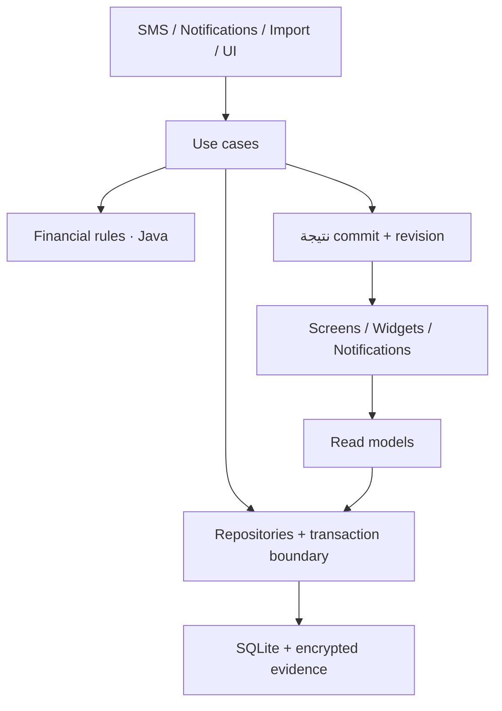

# Follow Money — خطة إصلاح وتفكيك تدريجي

**الحالة:** قيد التنفيذ بدفعات مستقلة؛ ChatGPT ينفّذ ويتحقق، وClaude يراجع بشكل مستقل قبل الدمج، مع CI على نفس الـhead، وفق قرار محمد في 18 أكتوبر 2026. اعتماد الخطة لا يعني اكتمال مراحلها؛ نتائج كل دفعة وحدودها موثقة في PR الخاص بها. البنود المعلّمة بـ «إضافة Claude» جزء من الخطة المعتمدة.
**التاريخ:** 17 أكتوبر 2026.
**صاحب القرار:** Mohamed Gamal.
**المرجع الأصلي للخطة:** checkout ce35e83؛ MainActivity: 6,265 سطر، ExpenseDb: 2,910، ExpenseParser: 577. هذه أرقام baseline تاريخية وليست قياسات الحالة الحالية.
**النطاق:** موثوقية lifecycle المالي، فصل المسؤوليات، سلامة البيانات، مراجعة الحالات غير المؤكدة واختبارات منع الارتداد.

## السياق والقرار المعماري المقترح

التطبيق Java 17، native Android Views، SQLite، وموديول واحد. المسؤوليات المالية والتخزينية والعرض متداخلة؛ نقل النص بين الملفات وحده لن يفصلها.

نوصي باستخراج تدريجي داخل الستاك الحالي، مع واجهات توافق مؤقتة واختبارات سلوكية. كل دفعة مسؤولة عن رحلة محددة. إصلاح عالي الخطورة يمكن تقديمه بعد اختبار يثبت المشكلة، دون انتظار تفكيك كامل.

| البديل | الفائدة | التكلفة/المخاطرة | القرار المقترح |
| --- | --- | --- | --- |
| إعادة كتابة شاملة أو تغيير Java/Views/SQLite | حرية تصميم كاملة | تغيير UI ومنطق وتخزين معًا يصعّب إثبات حفظ البيانات | مؤجل وخارج الخطة |
| تقسيم MainActivity إلى ملفات UI فقط | مراجعة أسهل جزئيًا | تبقى المعاملات والقواعد المالية متشابكة | جزء من مرحلة الواجهة |
| استخراج use cases وrepositories وشاشات تدريجيًا | تغيير قابل للمراجعة والاختبار مع استمرار التطبيق | واجهات توافق مؤقتة وتتابع نقل منضبط | الموصى به |

لا تحتاج البداية مكتبة جديدة. أي اقتراح لإضافة مكتبة أو scheduler جديد يُذكر باسمه ومبرره قبل تطبيقه. تسميات الكلاسات أدناه مقترحة وتراجع مع conventions عند التنفيذ.

## النتيجة المستهدفة

- MainActivity يستضيف التنقل، الربط مع lifecycle وحالة العودة؛ كل شاشة/رحلة لها مكوّن مستقل.
- ExpenseDb يبقى SQLiteOpenHelper وإنشاء/ترقية schema؛ SQL الخاص بكل مجال ينتقل إلى repository مناسب.
- use case هو مالك transaction للحدث المالي؛ helper تابع لا يفتح transaction متداخلة مبهمة ولا يبتلع فشلها.
- CaptureResult وMutationResult صريحان، بدل boolean وحقول lastCapturedId/lastCaptureEvent القابلة للتغير.
- مسار كتابة مالي متسلسل ومحدد للالتقاط والاستيراد والتعديل والإصلاح؛ لا DB write على UI thread.
- القواعد المالية لا تعتمد على Activity أو NotificationManager.
- العرض والتنبيهات والwidgets تستقبل نتيجة commit وتقرأ نموذج العرض الحالي.
- إعادة إرسال نفس المصدر آمنة؛ إعادة التحليل بعد تحديث parser مسار مستقل بمعاينة وإصدار وسبب.
- نتيجة المرشح المالي تكون محفوظة، مكررًا مثبتًا، تجاهلًا مسببًا، مراجعة قابلة للتصرف، أو فشلًا ظاهرًا له متابعة.

الـdurable inbox يعالج ما استلمه التطبيق وحفظه فعلًا. لا يضمن الوصول لرسالة أو إشعار لم يسلّمه Android، أو التعافي من uninstall أو فقد مفتاح Keystore.

## سجل موحد للمشاكل

المراجع هنا IDs من audit المحادثة ذي 108 عقد. تقرير Claude الأحدث موجود في [fm-lifecycle-audit.md](D:/M.Gamal/Learn/Projects/1/Claude%20outputs/fm-lifecycle-audit.md)، ويتضمن نتائج مشتركة وتصحيحات. ملف Downloads Markdown وحده لا يحتوي بيانات الخريطة.

نربط كل finding باختبار/قرار؛ العدد لا يساوي عدد bugs مستقلة. تصنيفات البداية: مثبت من الكود، سيناريو يحتاج reproduction، قرار منتج، أو استنتاج مصحح/غير قابل للوصول. أي bug لا يغلق إلا بدليل مطابق لنطاقه.

| Work item | المشكلة | Audit IDs | IDs في خريطة Claude | المرحلة |
| --- | --- | --- | --- | --- |
| FM-01 | رسالة غير مفهومة أو خارج preview | E5، E11، P10، R5، R7، R15 | P7b، P7c، D1b | 3 |
| FM-02 | فشل الالتقاط واسترداد العمل | E7، E8 | QX | 3 |
| FM-03 | نتيجة استيراد SMS والمعاملة الداخلية | S10 | I4 | 1 |
| FM-04 | دفعات CSV والتكرار والاستعادة والالتزامات | E16، S23، U16، R18 | V3 | 1,7 |
| FM-05 | حفظ الأدلة والأرصدة وفشل التشفير | S6، S22، U8، U20 | S6، B1 | 3 |
| FM-06 | نتيجة capture صريحة وإعادة المعالجة | S2، E21، S7 | D2b | 2,3 |
| FM-07 | هوية الإشعارات ومتابعة تعديلاتها | U11، U12، R12 | N1a، M2b | 1,5 |
| FM-08 | تحديث الشاشات والـcache | U13، U14، U18 | — | 2,6 |
| FM-09 | قوة قرائن إزالة التكرار | S4، S9 | — | 4 |
| FM-10 | حسم الإلغاء وإتاحة تاريخ الإصلاح | S14، S15 | P5b | 4 |
| FM-11 | ضمان حفظ رسوم التحويل | S21 | — | 1 |
| FM-12 | أثر تعديل الاسترداد ودلالة الميزانية | S19، U17 | — | 4,7 |
| FM-13 | تسوية القسط وربطه وإعادة حسابه | R9، R8، R6، R17، R3، R14 | R9، R0b، R0c، M1 | 5 |
| FM-14 | الغموض المالي والتاريخ والمستقبل | P12، P14، P15، R1 | P3 | 3,4 |
| FM-15 | القرارات المتعلقة بتأكيد الدفع والملكية والديون | C6، R10، R13، R19 | M2a، M3، X1 | 0,5,7 |
| FM-16 | TR2: إظهار التحويل المتروك بسبب رفض الرسوم، وربط دون رسوم بتأكيد صريح | TR2 — بلاغ 18 أكتوبر | لم يضف للخريطة بعد؛ ينتظر مراجعة Claude | 1,4 |

**قرار TR2 (محمد، 18 أكتوبر): option 2.** لا ربط تلقائي دون رسوم؛ الخصم المتروك يعلّم «تحويل محتاج ربط». المسار اليدوي يعرض سبب الرفض ويتيح «اربط بدون رسوم» بتأكيد يذكر مبلغ الرسوم الذي لن يحتسب في المصروفات، مع حفظ القرار في ملاحظة العملية. TR1 يظل محميًا: لا تقليص صامت للخصم. الحالة تنتظر مراجعة Claude؛ نجاح الاختبارات وحده لا يغلقها.

عمود «IDs في خريطة Claude» يربط كل بند بمربع في الخريطة التفاعلية؛ لما البند يتقفل، المربع يتحول أخضر في نفس الـ PR. (إضافة Claude)

تغطي الخريطة جميع IDs الـ47 المصنفة OPEN/DECISION في التقرير السابق دون تكرار. بعض القرارات سيغلق بتوثيق سلوك مقصود؛ لا تتحول جميعها تلقائيًا إلى features.

## 0 — baseline وتنقية المراجعة

**المخرجات**
- تشغيل checks الحالية وتسجيل الفشل السابق للتغييرات منفصلًا عن أي regression.
- baseline من fixtures صناعية: counts وIDs والمبالغ/العملة/النوع، الحسابات، الأدلة، الروابط، الرسوم، exclusions، الأرصدة والالتزامات.
- مراجعة كل finding باختبار وصول/فشل. مثل branch قيمة غير موجبة: هل يصل إليه parser التلقائي فعلًا أم guard فقط؟
- اعتماد الدلالات المقترحة أدناه قبل تغيير السلوك المرتبط بها.
- branch محلي عند بدء الكود، وعدم إدخال ملفات agents أو مخرجات المستخدم غير المرتبطة في دفعات التغيير.
- **(إضافة Claude) فجوة الـ CI:** android-ci.yml يشغّل run-checks.ps1 -Online من غير -Android، يعني الـ 17 JVM suite والـ build/lint بس. اختبارات SQLite (ReconciliationTest وUpgradeInstallTest) مش بتشتغل على أي PR. وإصلاحات المرحلة 1 كلها SQLite. **القرار (محمد، 17 أكتوبر): job فيه emulator في الـ CI.** أول دفعة في الخطة بتضيفه، ولحد ما يشتغل مفيش ولا PR يلمس ExpenseDb يتعمله merge. من غير ده، «الاختبارات ناجحة» في الـ PR مش هتثبت حاجة عن مسار الحفظ.
- **(إضافة Claude) تجميد:** طول المرحلتين 1 و2 مفيش أي agent تاني (DeepSeek أو غيره) يفتح PR على ExpenseDb.java أو MainActivity.java أو SmsReceiver.java أو PaymentNotificationListener.java، إلا لو كان جزء من الخطة دي.
- **(إضافة Claude) حسم القرارات:** جدول المرحلة 7 فيه عمود «قرار محمد». أي دفعة بتغيّر سلوك مرتبط بقرار فاضي تقف لحد ما يتملى.
- **(إضافة Claude) مكان الخطة:** الملف يتنقل لـ docs/refactor-plan.md ويتعمله commit في أول دفعة، عشان كل agent يقرا نفس النسخة.

**شرط الخروج:** baseline قابل للإعادة وbacklog موحد مع evidence وexpected outcome. لا تُستبدل نتائج الاختبارات بتقارير نجاح قديمة.

## 1 — تثبيت الحفظ والنتيجة

**تغييرات صغيرة منفصلة**
1. اختبار فشل repair داخل استيراد SMS، ثم إصلاح وصول الفشل إلى مالك transaction؛ لا flags نجاح إلا بعد commit مؤكد.
2. batch CSV atomic مبدئيًا: saved/duplicates/failed مع رسالة عربية واضحة؛ fault عند الصف N لا يترك نصف دفعة ناجحة.
3. فصل التحويل والرسوم في transaction واحدة؛ رفض حفظ fee يمنع نجاح التقسيم الصامت.
4. هوية PendingIntent فريدة لكل كيان وإجراء، مع اختبار عمليتين متتاليتين؛ إجراء «دفعته» يعالج نتيجة no-op/failure.

**شرط الخروج:** اختبارات فشل مقصودة تثبت صفر نجاح كاذب وصفر تغيّر مالي جزئي في هذه الرحلات. التنفيذ لا يغيّر parser أو شكل الشاشات في نفس الدفعة.

## 2 — استخراج حدود التطبيق والتخزين

**التدرج**
- تقديم CaptureRequest/CaptureResult وMutationResult أولًا. النتيجة تصف transaction IDs، evidence outcome، dbChanged، needsReview، وسبب التوقف.
- استخراج CaptureTransaction/ImportBatch/TransactionMutation كرحلات، مع ExpenseDb facade مؤقتة حتى تنتقل call sites.
- استخراج repositories حسب المسؤولية: transactions/evidence، accounts/balances، commitments، reimbursement/card settlement؛ لا نخلق repository لكل table بلا حاجة.
- نقل ownership للـDB والworker إلى نطاق التطبيق؛ Activity لا تغلق موردًا ما زالت عملية خلفية تستخدمه.
- التغيير المالي يكتب revision مع commit، ثم ينشر invalidation. إذا مات التطبيق قبل النشر، قراءة revision في الفتح/resume تكشف التغيير.
- تجهيز استبدال الاختبارات المرتبطة بأسماء private methods في MainActivity باختبارات العقود والسلوك المكافئة؛ لا نحذف regression لمجرد أن الاسم تغير.

**شرط الخروج:** نفس المخرجات والبيانات في extraction-only batches، وغياب SQL/قواعد مالية من call sites المنقولة. لا تبقى نسختان متنافستان من نفس قاعدة الحساب.

## 3 — التقاط دائم ومركز مراجعة

**التخزين**
- إضافة schema تدريجية للمرشحات المالية مع body مشفر، هوية المصدر، وقت الاستلام، provenance، parser version، attempts وlastErrorCode.
- حالات منفصلة عن نوع المعاملة: RECEIVED، PROCESSING، RETRYABLE_FAILURE، NEEDS_REVIEW، PROCESSED، IGNORED.
- PROCESSING لها lease؛ العمل المتروك بسبب موت process يعاد امتلاكه. retry محدود مع backoff؛ بعد استنفاد المحاولات ينتقل لمراجعة واضحة.
- worker الحالي يقرأ التخزين الدائم. اختيار آلية إعادة تشغيل background من APIs المتاحة يختبر على الحد الأدنى للإصدار؛ لا نفترض أن thread بالذاكرة يكفي.
- OTP والمحتوى غير المالي لا يخزنان كرسائل مالية. فحص المرشحات يراجع لضمان تقليل false positives، دون ادعاء فهم كل صيغ البنوك.
- عند فشل التشفير: metadata فشل ظاهرة دون raw text في اللوج أو plaintext fallback. إعادة جلب المصدر مشروطة ببقائه وإتاحته؛ الإشعار الذي زال قبل حفظه لا نعد باستعادته.
- تمييز missing legacy evidence عن encryption_failed وعن decrypt_failed.

**رحلة المستخدم**
- عداد واضح وفلتر حسب السبب.
- فتح المصدر ← تصحيح/اختيار حساب أو خطة ← معاينة الأثر ← تأكيد ← نتيجة وتراجع حيث ينطبق.
- الرسائل غير المفهومة تظهر أيضًا في فحص التاريخ؛ لا تتحول إلى مصروف مؤكد دون مراجعة.
- حالات balance-only وpaid-service وplan-completed والإلغاء بلا مطابق قابلة للحسم؛ dismiss يحفظ السبب والتاريخ.
- حدود حجم واحتفاظ وحذف للمصادر المشفرة، وحذف البيانات يشمل inbox وكل الأدلة الجديدة.

**شرط الخروج:** لكل fixture مالي outcome قابل للاستعلام والفهم؛ قتل process بعد حفظ المصدر ثم إعادة التشغيل لا يكرر القيد ولا يترك PROCESSING للأبد.

## 4 — تسوية وتحليل محافظان

- فصل SourceDeduplicator عن TransferReconciler وعن تصنيف التاجر؛ كل منهما يعطي سببًا وقرائن match.
- هوية مصدر مؤكدة تمنع إعادة التسليم؛ تشابه مبلغ/وقت وحده لا يحذف عملية. قرائن ضعيفة تعرض اقتراحًا.
- مبالغ متعددة أو عملة غير محسومة تذهب للمراجعة؛ التحويل بلا عملة لا يفرض EGP لمجرد تطابق صيغة عامة.
- حفظ bank_event_time/message_received_time/time_provenance منفصلة؛ legacy unknown يظل unknown.
- فصل future obligation extraction عن completed payment booking.
- ربط snapshot رصيد بدليله، ومراجعة اختيار الحساب عند غياب هوية كافية. وجود حساب واحد لدى بنك لا يثبت تلقائيًا أنه الحساب المقصود.
- عرض تاريخ التسويات والإصلاحات والإلغاءات، مع إجراء حسم للإلغاء غير المطابق.
- سحب الكاش bucket مستقل: لا يُحسب صرفًا ولا يدخل `totalOut` أو الميزانية أو الحد اليومي أو النقاط، والرسوم المنفصلة تبقى مصروفًا. لا محفظة كاش ولا مطالبة بتسجيل صرف. القرار في 19 أكتوبر، والتفاصيل في قسم «قرارات 19 أكتوبر 2026».
- اختبار تعديل transaction المرتبطة باسترداد: معاينة الأثر، تحديث/فصل الرابط بقرار صريح، وعدم محو أصل الحركة لتصحيح الإجمالي.
- auto-repair لا يكتب أثناء العرض؛ يشغّل على scope معلوم، ويحفظ change history ونتيجة الفشل.

**شرط الخروج:** إعادة نفس المصادر آمنة، المدفوعات المتشابهة الحقيقية لا تدمج بلا دليل، والأثر المحاسبي قابل للتفسير من المصدر والروابط.

## 5 — التزامات مبنية على تسويات دورات

- استخراج CommitmentPaymentService بعد ثبات حدود المعاملات.
- تعريف دورة استحقاق وهوية settlement تربطها بواحد أو أكثر من الدفعات الجزئية أو بتأكيد يدوي واضح؛ نفس الدفعة لا تسوي مرتين.
- المدفوع/المتبقي والموعد مشتقان من تسويات صالحة، مع سياسة صريحة للسداد المبكر والجزئي والتأخر وتغير المبلغ.
- تعديل/حذف/إلغاء الدفع يعيد حساب الدورات المتأثرة ذريًا؛ لا نرجع paid_count خطوة عمياء لأن المدفوعات قد تكون جزئية أو معادة الترتيب.
- import قديم أو CSV لا يقدم الجدول تلقائيًا دون ربط دورة مؤكد.
- مطابقة أكثر من التزام أو اختلاف مبلغ تعرض اختيارًا؛ paidService لا يعلّم عدة خطط أو عملات بنفس الرسالة.
- ربط provider confirmation الذي لا يحتوي مبلغًا يكون تأكيد حالة يحتاج تطابقًا موثوقًا، ولا يخترع قيدًا ماليًا.
- confirm repeating suggestion لا يخفيه أو يغيّر تاريخه المالي إلا عند نجاح إنشاء الالتزام.
- التذكير يملك نتيجة إجراء واضحة، وهوية كيان، وإلغاء/تحديث عند تغيير الحالة؛ «دفعته» لا يولّد مصروفًا ثانيًا.
- المطابقة التلقائية للدورة تستخدم الطرف الآخر + المبلغ + العملة + دورة الاستحقاق، ولا تنشئ مصروفًا ثانيًا؛ الغموض فقط يطلب تدخل المستخدم. القرار في 19 أكتوبر، والتفاصيل في قسم «قرارات 19 أكتوبر 2026».

**الهجرة:** الجداول القديمة لا تثبت IDs دفعات التاريخ. ننقل الحالة الحالية كـlegacy baseline ذي provenance واضح، ونطلب مراجعة الروابط غير المثبتة. لا نخترع تاريخ مدفوعات.

**شرط الخروج:** create/link/partial/edit/delete/cancel/undo/import/out-of-order تسوّي نفس الدورة مرة واحدة، وتطابق حالة التنبيه.

## 6 — تفكيك MainActivity حسب الرحلات

التفكيك يبدأ تدريجيًا بعد المرحلة 2، ويستكمل هنا بعد استقرار عقود المجالات.
- TransactionsScreen + TransactionDetails/Editor.
- CommitmentsScreen + CommitmentEditor.
- AccountsScreen + balances.
- Reports/Monthly/Daily/Points screens.
- نقاط الأيام تُحسب تلقائيًا بعد انتهاء اليوم مع backfill وإعادة حساب عند التصحيح أو وصول عملية متأخرة، والحد التاريخي هو الحد الفعّال وقتها. القرار في 19 أكتوبر، والتفاصيل في قسم «قرارات 19 أكتوبر 2026».
- Settings وCSV UI، ثم Onboarding/Assets/Debts حسب الحاجة.
- presenters/controllers باستخدام composition وconstructor injection؛ لا ننشئ MegaManager أو BaseScreen ضخمًا.
- shared UI primitives الموجودة يعاد استخدامها دون تغيير palette أو إعادة تصميم غير مطلوبة.
- قراءة immutable view state؛ تفاصيل transaction تعاد بالـID/current revision عند mutation.
- الحفاظ على Back/search/filter/scroll/dialog selection والمسودات عبر rotation/resume.
- تحديث التنبيهات والwidgets بعد commit؛ فشل output لا يحوّل commit ناجحًا إلى «فشل حفظ» أو العكس.

**شرط الخروج:** MainActivity لا يحلل رسائل أو يحسب مالية أو ينفذ SQL. اختبارات UI تثبت الرحلات والسياق، مع light/dark وRTL وlarge fonts.

حجم الملف مؤشر تنبيه: مراجعة أي ملف جديد يتجاوز تقريبًا 500 سطر أو يجمع أكثر من مسؤولية. لا نقسم function تعسفيًا لتحقيق رقم.

## 7 — استكمال قرارات المنتج وقبول النسخة

| القرار | التوصية المبدئية | قرار محمد |
| --- | --- | --- |
| «دفعته خلاص» | اختيار ربط دفع موجود أو تسجيل دفع يدوي؛ confirmation-only يصرح بأنه لا يضيف مصروفًا | موافق على التوصية (17 أكتوبر) |
| قواعد الثقة | الغموض للمراجعة؛ لا ربط قسط أو دمج دفعتين لمجرد المبلغ | موافق على التوصية (17 أكتوبر) |
| رصيد بلا last4 | اختيار حساب بمعاينة، دون إسناد صامت | موافق على التوصية (17 أكتوبر) |
| الميزانيات بعد reimbursement | استخدام personal-net افتراضيًا لميزانية الصرف الشخصي مع إظهار gross منفصلًا؛ يعتمد قبل تغيير السلوك | موافق على التوصية (17 أكتوبر) |
| حذف عملية | أرشفة مع Undo، مع حماية الإلغاءات البنكية المؤكدة من الاستعادة كعملية نشطة بالخطأ | موافق على التوصية (17 أكتوبر) |
| إزالة own handle | شرح المستقبل مقابل الماضي، ومعاينة إعادة التصنيف التاريخي | موافق على التوصية (17 أكتوبر) |
| الإلغاء غير المطابق | حسم/غير متعلق مع مصدر وسبب، دون إسقاط حقيقة الإلغاء البنكية | موافق على التوصية (17 أكتوبر) |
| التأخير بعد 3 أيام | تذكير متكرر قابل للضبط وsnooze؛ لا سلسلة مزعجة تلقائيًا | موافق على التوصية (17 أكتوبر) |
| CSV | دعم import/export للأنواع المعلنة والتحقق من الملف قبل الحفظ؛ لا نسميه backup | موافق على التوصية (17 أكتوبر) |
| backup كامل | بند منفصل يحتاج تصميم آمن لنقل مفتاح/إعادة تشفير الأدلة؛ نسخ DB وحدها غير كافٍ | موافق على التوصية (17 أكتوبر) |
| سداد الدين | history وربط بحركة موجودة؛ إنشاء حركة جديدة يحتاج اختيارًا يمنع ازدواج التسجيل | موافق على التوصية (17 أكتوبر) |

البنود التي تضيف قدرات منتج قابلة للتأجيل، مع قرار موثق؛ لا تعطل إصلاحات فقد البيانات أو إثبات النتيجة. لا نعتبر الخطة ضمانًا لإغلاق كل ثغرة مستقبلية؛ نحدد ما اختبرناه وما بقي.

## التحقق المطلوب

نستخدم [run-checks.ps1](D:/M.Gamal/Learn/Projects/1/tools/run-checks.ps1) والاختبارات الموجودة. التنفيذ الحالي يشمل 17 JVM suite ثم debug build/lint/instrumentation build؛ تشغيل Android اختياري وعلى emulator صناعي.

| المستوى | حالات مطلوبة |
| --- | --- |
| JVM | parser متعدد الصيغ، الغموض، العملات، وقت البنك/الاستلام، dedup قرائن، eligibility، حسابات التدفق والدورات |
| SQLite integration | فشل منتصف الدفعة، nested rollback، كتابة fee/evidence، atomic linked edits، concurrent duplicate delivery |
| Android | SMS/notification extraction، PendingIntent actions، الكاش والـrevision، إشعارات قديمة، lifecycle وrotation |
| Fault injection | encryption failure، DB write failure/full/locked، process death بعد كل مرحلة، retry exhaustion، مصدر لم يعد متاحًا، وقت/منطقة زمنية تغيرت |
| Upgrade | fixtures للـschema السابقة؛ data/links/evidence/exclusions/preferences لا تتغير إلا بقرار محدد؛ fresh install والترقية كلاهما |
| Privacy/input bounds | OTP، مصادر غير مختارة، shared text/CSV كبير أو تالف، logs بلا نص مالي، إشعارات مخفية، delete-all يشمل الجداول الجديدة |
| Scale | بيانات صناعية وحجوم دفعات متزايدة؛ query latency والذاكرة وتجاوب UI يقاسان مقابل baseline قبل وضع حد قبول |
| Financial replay | counts وgross/effective totals منفصلة بالعملة والفترة، transfers/fees/refunds/balances والروابط؛ كل فرق مقصود موضح |

[RealDataReplay.java](D:/M.Gamal/Learn/Projects/1/tools/RealDataReplay.java) مساعد لمقارنة قواعد pure Java ومجاميع محددة؛ ليس replay كاملًا للـSQLite/capture أو Keystore أو واجهة Android. لا يكفي وحده لإثبات صحة lifecycle. البيانات الواقعية تحتاج إذنًا منفصلًا ونطاقًا واضحًا؛ لا تصدير أو rescan للهاتف ضمن هذه الخطة.

عند extraction فقط: صفر فروق في النتائج المتوقعة. عند bug fix: فرق محدد في fixtures المصابة، وعدم فروق غير مفسرة في غيرها.

## تقسيم العمل والمراجعة

التنفيذ المقترح 10–12 دفعة مراجعة صغيرة كبداية، وقد تزيد إذا استدعى scope ذلك؛ ليست حصة ثابتة نجمع داخلها تغييرات غير مترابطة:
1. baseline + triage والعقود.
2. فشل SMS repair وصدق نتيجة الاستيراد.
3. CSV atomicity.
4. fee atomicity + notification identities كدفعتين إذا اختلفت الاختبارات.
5. CaptureResult/transaction ownership والـfacade.
6. durable intake وإدارة retry.
7. مركز المراجعة والأدلة.
8. dedup/reconciliation/time semantics على دفعات مستقلة.
9. cycle settlement migration والربط وإعادة الحساب.
10. UI extraction لكل رحلة مستقلة.
11. إغلاق القرارات المقبولة والتحقق من الترقية.
12. acceptance شامل ومراجعة release.

لا commit أو push أو إنشاء PR قبل طلب المستخدم. كل دفعة تقدم diff صغيرًا، اختبارات مناسبة، الأثر المالي المقصود، وحدود التحقق.

**(إضافة Claude) أدوار التنفيذ والمراجعة**

**تحديث ملزم — قرار محمد، 18 أكتوبر:** «انت بتعمل كل حاجة وكلود هيراجع بعدك». ChatGPT ينفّذ ويختبر ويجهّز PR؛ مراجعته الذاتية ليست موافقة مستقلة. Claude يراجع الـfull head SHA بعده، ويظهر تقريره وقراره وروابط CI في PR قبل الدمج. أي commit جديد يحتاج تجديد موافقة Claude وCI. التوزيع التالي تاريخي ويحل محله هذا القرار؛ لا يُنسب تنفيذ سابق إلى Sonnet بأثر رجعي ولا يُفترض أن ملخص COMMENT يساوي GitHub APPROVED من مراجع مستقل.

- المنفّذ (Sonnet): branch منفصل لكل دفعة، والدفعة يا نقل كود يا إصلاح، وميجمعش الاتنين. دفعة الإصلاح تبدأ بـ test يفشل قبل الإصلاح، ويبان في الـ PR إنه فشل.
- مراجعة ChatGPT: صحة الإصلاح تقنيًا، والـ transactions، وحالات الفشل.
- مراجعة Claude: السلوك اللي المستخدم بيشوفه متغيرش إلا في المقصود، وتحديث الخريطة.
- محمد: يحسم القرارات ويعمل merge. ممنوع أي merge من غير الموافقتين.
- حجم الدفعة: الهدف أقل من 400 سطر diff، من غير حساب الملفات اللي اتنقلت زي ما هي. لو أكبر من كده، المنفذ يقسمها ويشرح ليه.

## بوابة قبول كل دفعة

- [ ] اختبار سلوكي يثبت الحالة المعنية؛ regression ثابت بعد الإصلاح.
- [ ] build/lint والاختبارات المناسبة ناجحة، أو الفشل موثق والدفعة غير معتمدة.
- [ ] لا raw SQL/financial rule جديدة في Activity ولا UI dependency في المجال.
- [ ] مصدر واحد لكل قاعدة، وtransaction owner واضح ونتيجة post-commit.
- [ ] لا تغييرات مبالغ/عملة/نوع/روابط بلا expected diff.
- [ ] ترقية schema additive أولًا؛ legacy unknown لا يتحول إلى دليل مؤكد.
- [ ] مراجعة استهلاك الموارد والخصوصية عند إضافة تخزين أدلة أو retry.
- [ ] تحديث architecture/usage/lifecycle map للحالات المتأثرة فقط.

الرجوع عن كود بعد schema upgrade لا يعني تثبيت APK أقدم على البيانات الجديدة. خطة التراجع تستخدم توافقًا معروفًا أو نسخة احتياطية محلية قابلة للتحقق مع مفاتيحها؛ تختبر على بيانات صناعية قبل أي استخدام حقيقي.

## الحالة عند تسليم الخطة الأصلية

عند التسليم الأول كانت الجولة قراءة مصادر واختبارات وتقارير فقط، دون تشغيل الاختبارات أو تعديل Android source أو schema أو بيانات المستخدم. بدأ التنفيذ بعد ذلك بتفويض محمد؛ يُرجع إلى PRs الدفعات ونتائج CI المطابقة للـhead لمعرفة التقدم الفعلي. نجاح extraction منفرد لا يغلق المرحلة 2 أو يثبت تسليم SMS وإشعارات حقيقية أو القبول الشامل.

---

## P2-A capture contract and synthetic baseline

Base: `f9ae8ce6ab9bd595b442bb866c2e1b99794120bd` (PR34). This batch starts P2-A;
it does not close Phase2, P2-C transaction ownership, REV-L4, or import/mutation result work.
No parser, eligibility, currency, consent, schema, library or ledger policy change is intended.

### Fixtures and explicit result corrections

`AuditRegressionTest.testCaptureBaseline*` was added before production edits. The original
test source and run receipts are preserved locally in `.tmp/p2a-baseline-*`.
Amounts below are minor units. Revisions are persistent invalidation tokens, not row counts.
`legacy` means the old `CaptureResult.dbChanged` / boolean API, which reports acceptance rather
than all writes. Exact duplicate evidence replacement can advance revision; that churn stays open.

| Fixture / test | Expected result (legacy baseline or named contract test) | Committed rows / links / evidence / revision |
| --- | --- | --- |
| Fresh SMS; FreshDuplicateAndIgnored | legacy true, created transaction, no event | One EGP expense, gross/effective 10000; one attached evidence; no reimbursement; revision advances |
| Exact same SMS; FreshDuplicateAndIgnored | legacy false, no created transaction/event | Same ID, amount/currency/count; evidence replaced (still one); revision advances |
| Null / OTP / excluded; FreshDuplicateAndIgnored | legacy false, no row/event | No new rows/links/evidence; revision unchanged (exclusion setup excluded) |
| Balance only; SideEffectWithoutLedgerRow | legacy false, no created row/event | Zero ledger rows, one balance snapshot of EGP 100000; no capture_evidence; revision advances |
| Unmatched cancellation; ReviewAndHistoricalConsent | legacy true, needs_review event | Zero ledger/archive/evidence rows; encrypted body in capture_events; revision advances |
| Repeated cancellation; ReviewAndHistoricalConsent | legacy false, no new event | Existing event unchanged; revision unchanged |
| Historical cancellation; ReviewAndHistoricalConsent | import count 0 | One needs_confirmation event and receipt; no automatic archive; no ledger row |
| Outer caller rollback; CallerRollbackRestoresAllRowsAndRevision | old result returns before outer commit | In-flight row/balance/source/evidence visible, then complete table snapshot and revision restored; helper open |
| Evidence SQL ABORT; EvidenceFailureRollsBackStorage | exception, no success result | All storage tables and revision unchanged; helper open |
| Live repair SQL ABORT; LiveRepairFailureRetainsCommittedCapture | legacy true, swallowed repair error | Prior notification plus newly committed SMS = two rows/evidence; repair archive rolls back; revision advances. Final contract adds COMMITTED_REPAIR_FAILED; ownership remains a P2-C dependency |
| Notification + bank copy; existing CaptureUseCaseKeepsEarlierSnapshotsAndSourceIdentities | legacy true, surviving created row | One EGP 10000 row, two evidence sources, archive of removed copy; earlier result remains a snapshot |
| Merge with reimbursement/fee/origin; existing AutomaticPurchaseMergePreservesRepaymentFeesOriginAndEvidence | surviving ID | Gross 10000, effective 6000; income 4000 offsets to 0; fee/origin/reimbursement/evidence follow kept ID |
| Matched cancellation; existing CaptureOutcomeNewDuplicateCancellationAndMergeFollowed | event cancelled, no created row | Debit archived with its evidence; event refers to archive/original ID; zero active canceled debit |
| SMS batch repair failure; existing SmsImportRepairFailureRollsBackBatchAndIsReported | exception | Whole batch/receipts/repair rollback, unlike live's separate owners |
| CSV false/throw and missing mutation; existing CSV and mutation regressions | failure / NOT_FOUND | Existing atomicity and no-learning assertions retained; no contract expansion for these APIs in this batch |
| Evidence SQL IGNORE; ContractEvidenceRefusalDoesNotInventSuccessfulEvidence | accepted capture, evidence NOT_APPLIED | One EGP 10000 ledger row; no evidence row, no invented review flag; revision advances. Existing storage policy retained |
| Future-only notice matching a legacy row; ContractReviewMarkerAndRefusalHaveMatchedIds | accepted false, committed change, needsReview true, matched ID | Original amount/currency retained; review marker updates; no new ledger/evidence; revision advances |
| Ignored merchant; ContractReviewMarkerAndRefusalHaveMatchedIds | INSERT_NOT_APPLIED | No new row/evidence; no invented refusal cause; no revision change for this fixture |
| Incoming own transfer; ContractIncomingOwnTransferFollowsMergeBeforeFeeIdReuse | created receipt follows outgoing ID | Gross debit 10050 becomes principal transfer 10000 plus fee expense 50; incoming archived; evidence follows outgoing; numeric ID reuse does not identify the fee as captured principal |
| Actual SMS producer; ConsumerBroadcastsCommittedBalanceOnlyChange | one DATA_CHANGED broadcast | One balance snapshot, zero ledger rows; no transaction notification fabricated |
| Early merge then later fee-write failure; ContractFailedRepairDiscardsRolledBackMergeAliases | COMMITTED_REPAIR_FAILED, committed capture ID retained | Four original/captured rows, two evidence rows, zero repair archives/fees; debit 10050 and receipt 10000 unchanged; aliases from the rolled-back repair are discarded |

### Contract change, separate from extraction

There is no extraction-only claim for this batch. Request-local storage observations replace
the journey's reads of shared `lastCapturedId` / `lastCaptureEvent`; compatibility accessors remain
for older boolean callers. SQL policy and transaction ordering stay in their existing owners.
The deliberate result correction distinguishes legacy acceptance from observed committed revision
change, including evidence-only and balance-only writes. Live producers consume the corrected
committed-change signal, and row/event notifications require a completed standalone call.

The first local-state-only patch is preserved separately in `.tmp/p2a-local-state-only.patch`.
The contract correction is intentionally separate from that patch: old `dbChanged` assertions
map to `accepted`, while two tests require the corrected committed-write signal to change.
Frozen before-correction APKs retain those tests before the fix. This is local evidence, not a
tests-first Git commit or an assertion that the final test file is byte-identical to the baseline.

`capturedTransactionId` identifies the initial insertion even when subsequently archived;
`transactionId` identifies the surviving matched row. An existing match is not labeled a proven
no-op or exact duplicate. `transaction` is returned only for a created surviving row. Evidence
reports `NOT_ATTEMPTED`, `SAVED_WITH_BODY`, `SAVED_WITHOUT_BODY`, `NOT_APPLIED`, or `EVENT_BODY`;
saved body presence does not assert decryptability or diagnose a missing body's cause.
`needsReview` reads actual row/event state; it does not invent a review marker for missing evidence.
Revision differences are global invalidation observations, not per-capture write attribution under
other writers. Source text, hashes and body diagnostics are not added to the result.

Storage and commit failures still throw. Legacy bounded live repair catches its own failures;
the result now exposes COMMITTED_REPAIR_FAILED, and consumers refresh the committed capture
without issuing a success notification. An outer transaction's result
is explicitly pending and cannot authorize success notifications. The result's revision is a
snapshot, not a promise that a caller will commit later. Live storage and repair remain separate
transactions, so repair failure can follow committed storage. Durable retry/recovery belongs
to P2-C/Phase3. No source text or private data belongs in result diagnostics or these fixtures.

Capture SQL string literals/order, marker predicates and storage transaction calls are compared
against the base; the merge body, parser, CaptureEvents, RepairRules, ImportBatch and
TransactionMutation remain unchanged. This is a focused source audit, not proof of every runtime
policy. Timestamp-aware booleans now construct snapshots too; no performance claim is made.
Import/mutation contract expansion, endTransaction fault injection, evidence recovery and write
serialization remain open. REV-L4 is unchanged.

Local verification: 17 JVM suites, debug/test builds and lint passed (0 errors, 66 existing warnings).
Revised base fixtures passed 73/0 on unchanged production; local-state-only production plus the
two result regressions passed 73 with exactly those 2 expected failures. Final native groups
27/14/31/83/30 passed (185/0), and isolated lifetime passed 4/0. These are uncommitted working-tree
results, not CI or independent approval. Logs, source snapshots, staged patches and hashes are
listed in `.tmp/P2A-review-request.md`. No private replay, physical device, visual acceptance,
process-death recovery, measured performance or new installed-upgrade acceptance is claimed.

Baseline refinement is explicit: the initial balance fixture omitted the parser's account marker
and saved no balance; it was corrected to `Account ending 1234`. The initial live-repair test
incorrectly expected an exception and failed because the base swallows that error. Its baseline
now pins the actual legacy acceptance and committed storage; a separate contract regression
asserts partial repair failure and surviving identity. Original failed logs/source remain local.
The first final base-suite run also exposed three old service assertions still using `dbChanged`
as acceptance inside an outer transaction. Only that field name changed to `accepted`; all paid
counts, dates, duplicate and rollback assertions remain identical. Final suites were rebuilt/rerun.

## P2-A import result contract (approved historical SMS batch and CSV batch)

The historical SMS batch and the CSV batch reported only a ledger row-count delta, so the number a
user saw was the net table change: a row whose sole effect was a receipt, a balance snapshot, a
hint, a recorded event or a commitment link reported nothing, and repair inside the same ±1 day
window moved rows the selection never named and, when both legs of a transfer were selected, rows it
did name.

`ImportBatch.executeDetailed` and `ImportBatch.applySelectedDetailed` return `ImportResult`;
`ExpenseDb.importCsvBatchDetailed` returns `CsvImportResult`. Legacy `long execute`, `long
applySelected`, `SmsImportActivity.applySelected`, `applyBatchWithRepair`,
`ExpenseDb.importCsvBatch` and `CsvBatchResult` keep their exact type and value: the historical SMS
write now delegates to `ExpenseDb.addHistoricalSmsObserved`, which returns the real
`CaptureResult.Write` instead of a boolean, and the receipt key is unchanged.

Primary outcomes are exclusive per selected row — created, matched existing, skipped duplicate,
excluded, refused, no ledger change — and always add up to `offered`. Reasons are read from stored
state: `CaptureResult.Reason` verbatim where one applies, `REVIEW_REQUIRED` for a recorded
cancellation, and `MERCHANT_IGNORED` from the stored merchant rule, which the capture write cannot
name. A skip names the table that already knew the key (`evidence`, `excluded`, `receipt`, `event`)
instead of claiming evidence was rewritten.

Side effects (`evidenceWritten`, `receiptWritten`, `hintWritten`, `balanceWritten`, `eventRecorded`,
`linksChanged`) and `repair` (`mergedRows`, `ownTransfers`, `feesCreated`, `archivedRows`,
`movedMinor`, `feesMinor`) are separate observations and are never folded into the primary totals.
Per row they are cheap key probes, and the commitment and hint tables are compared by value, not by
row count, so a next cycle paid on an already-paid commitment, a superseded proposal or a moved
observation is a change: a naive `last_paid_date IS NOT NULL` count missed the second cycle and made
an accepted service payment look refused. Reporting never scans `capture_evidence` or
`balance_snapshots` row by row, and a write already stored before a row is not attributed to it.

A row's identity after repair is its stored key, never its row number: SQLite reuses the id of a
deleted row, so repair's own fee inherits the archived transfer leg's id. `Row.initialTransactionId`
keeps the row the write produced, `Row.surviving` is true only while that same row is still live, and
`transactionId` names the merge target when repair folded the row into another one.
`ImportResult.archivedSelectedRows()` counts selected rows that no longer exist as their own row, so
a consumer can separate them from `repair.archivedRows`.

`committed`/`completion` follow the capture contract: `COMMITTED` only when the call owned the
transaction, otherwise `PENDING_CALLER` with `dbChanged=false`. A fault — including a repair fault —
publishes no result and rolls the whole batch back. `revisionBefore`/`revisionAfter` stay a global
invalidation observation, not per-row attribution under other writers.

Both consumers report the detailed result. The SMS import screen lists the selected rows' outcomes
and shows repair separately instead of presenting the ledger delta as the number of saved
operations; the CSV dialog splits created, already present and excluded instead of calling an
excluded line a duplicate. Neither screen reports success for a result that was not committed.

Fixtures record the cases that make the legacy value a poor report: `A13` shows a refused row still
writing the historical receipt, and `A9`/`A10` show repair moving rows the selection never named.
Open items elsewhere (this contract is not a fix for them): the CSV parser boundary and its
unreachable "row was not saved" branch, the ±120 s capture versus ±180 s repair window difference
behind `A10`, and REV-L4.

Review corrections (same batch, after the independent review of `ebad0a3`): a subsequent-cycle
service payment is observed as a commitment change instead of a refusal; surviving identity is
resolved through the stored key so a reused row number is never mistaken for a selected row, with
`initialTransactionId` and the merge target both reported; and the import screen no longer calls every
archived row unselected, naming the selected ones separately.

Local verification: 26 baseline fixtures committed first against unmodified production, then 24
contract fixtures with the compatibility pins. 17 JVM suites, debug/test builds, lint (0 errors, 66
existing warnings), native groups 27/14/31/133/30 (235/0) and isolated lifetime (4/0) passed on the
emulator. These are local results, not CI or independent approval. After the review corrections the
same suites ran again with 30 contract fixtures: native groups 27/14/31/139/30 (241/0) and isolated
lifetime (4/0).

## قرارات 19 أكتوبر 2026 — ثلاث دفعات مالية متتابعة

هذه القرارات لا تغلق مرحلة قائمة بذاتها، وتُنفذ كثلاث دفعات صغيرة مستقلة بالترتيب 1 ← 2 ← 3.
كل دفعة على branch وPR منفصل، باختباراتها وCI على نفس الـhead ومراجعة مستقلة قبل الدمج، ثم
التوقف قبل بدء الدفعة التالية. لا تُجمع تغييرات غير مترابطة في دفعة واحدة.

| الدفعة | القرار | الارتباط بالمراحل | شرط الخروج |
| --- | --- | --- | --- |
| 1 | سحب الكاش خارج كل مجاميع المصروف | Phase 4 (تعريفات `MoneyFlow` والتحليل) وPhase 6 (التقارير والwidgets) وFM-13 حيث تظهر حركة الحساب | نفس الصفوف والأدلة دون إعادة كتابة؛ السحب bucket مستقل، والرسوم تبقى مصروفًا، والحد اليومي والنقاط لا تتأثر |
| 2 | تسوية الالتزام تلقائيًا عند تطابق unambiguous | Phase 5 (تسويات دورات) وFM-13 | partial/recurring/cancel/refund/edit/delete/undo link تُسوّي الدورة مرة واحدة، ولا مصروف ثانٍ، والغموض فقط يحتاج تدخلًا |
| 3 | نقاط يومية تلقائية بلا lock/confirm يدوي | Phase 6 (شاشات النقاط) مع `DailySummary`/`DailyPoints` و`DailyAllowance` | backfill بلا تكرار، وإعادة حساب عند التصحيح أو العملية المتأخرة، والحد التاريخي هو الفعّال وقتها |

### 1) سحب الكاش ليس مصروفًا

- العملية تبقى كما هي في amount/currency/kind/category/evidence؛ لا migration ولا إعادة كتابة
  للتاريخ. إعادة الحساب مشتقة من نفس الصفوف.
- bucket جديد `CASH_WITHDRAWAL` يظهر في الledger باسم «سحب نقدي»، ولا يدخل `LIVING` ولا
  `expense`/`totalOut` ولا الميزانية ولا الحد اليومي ولا النقاط.
- الرسوم المنفصلة (رسوم تحويل أو fee child) تبقى مصروفًا؛ السحب نفسه تحويل من حساب متتبع إلى
  كاش غير متتبع.
- لا cash wallet ولا مطالبة بتسجيل صرف الكاش. التقارير تعرض السحب كسطر منفصل «من حسابك لكاش»،
  وحركة الحساب تظل gross مع تمييز السحب عن المصروف.
- التصنيف يأتي من نص الحركة المكتمل لا من اسم التاجر وحده: حدث سحب صريح («تم سحب…»،
  «cash withdrawal»، «withdrawn») يصبح `CASH_WITHDRAWAL` حتى لو لم يذكر ATM؛ والرسوم الصريحة
  المنفصلة (`fee`/رسوم/عمولة) تبقى `BANK_FEE_CATEGORY` داخل `LIVING`. الرسوم تُنسب للمبلغ
  المذكور معها فقط: «تم سحب 2000 برسوم 5» يظل أصله سحبًا ولا يُنشأ split غير مدعوم، والنفي
  («بدون رسوم»، «without commission») يخص كلمة الرسوم نفسها لا الرسالة كلها. لا تخمين لرسوم
  غامضة، ولا إعادة كتابة لصف قديم أو تعديل مستخدم.
- ربط الرسوم يستخدم موضع المبلغ المختار وعبارة إسناد صريحة داخل نفس الجملة؛ تساوي مبلغ
  السحب والرسوم لا يجعل موضعيهما واحدًا. وجود حساب أو مكان بين فعل السحب ومبلغه لا يغيّر
  ملكية المبلغ، ولا يُستعار أصل السحب كرسوم عند غياب مبلغها.
- لفظ خصم عام مثل «تم سحب»/`withdrawn` لا يلغي قرينة شراء أو جهة/تصنيف دفع مؤكدة؛
  سياق الكاش الصريح (`cash withdrawal`/ATM/«سحب نقدي»/صراف) يظل سحبًا نقديًا.
- روابط الاسترداد القديمة المرتبطة بسحب نقدي تبقى في `reimbursements` كسجل مراجعة، لكنها لا
  تُطبّق وقت القراءة على المصروف ولا على الوارد. تُعرض في تفاصيل الحركة للمراجعة ويمكن فكها
  دون حذف أي حركة أصلية أو دليل.

### 2) تسوية الالتزام تلقائيًا

- المطابقة بلا لبس بين transaction ودورة استحقاق تعتمد على الطرف الآخر + المبلغ + العملة +
  دورة الاستحقاق. المبلغ وحده لا يكفي.
- `paid`/`remaining`/التذكير تتحدث تلقائيًا دون إنشاء مصروف ثانٍ.
- partial payment والتكرار وإلغاء/استرداد الدفع وتعديل/حذف العملية المرتبطة وundo الربط تعيد
  حساب الدورات المتأثرة ذريًا.
- الغموض فقط يحتاج تدخل المستخدم. لا مسار مالي موازٍ؛ التنفيذ امتداد لتصميم cycle settlement
  الموجود في Phase 5/FM-13.

### 3) نقاط يومية تلقائية

- إلغاء شرط lock/confirm اليدوي؛ الأيام المنتهية تُحسب تلقائيًا.
- backfill للأيام الفائتة دون تكرار، وإعادة حساب عند تصحيح البيانات أو وصول عملية متأخرة.
- الحساب التاريخي يستخدم الحد اليومي الفعّال وقتها، دون اختراع حدود أو اكتمال لم يكن مسجلًا.
- فجوات التسجيل المعروفة تظهر بوضوح، دون إجبار المستخدم على فعل يومي.

### تنفيذ الدفعة 2 — تسويات الدورات التلقائية

- السحب في PR #37 دُمج بعد مراجعة Claude مستقلة وCI على الرأس الكامل `04a00e1`؛ merge
  `9dacebb`. تفويض محمد في 19 أكتوبر يسمح برفع الدفعتين التاليتين منفصلتين والاستمرار بعد
  اجتياز مراجعة مستقلة وCI لكل رأس، ولا يلغي بوابة الدمج.
- schema 25 يضيف هوية ثابتة للالتزام، و`commitment_cycles` و`commitment_payments`.
  الحقول القديمة للعدد والتاريخ الأخير هي إقرار/legacy baseline؛ لا نخترع روابط دفعات تاريخية.
  `next_due` المخزّن مؤشر الدورات غير المنشأة بعد؛ واجهة القراءة تعرض أقدم دورة غير مسددة.
  الحالات الحالية مشتقة من baseline وتسويات صالحة، ولا توجد نسخة مستقلة من المصروف.
- الربط التلقائي يتطلب جهة معروفة بحدود كلمات/هوية تاجر، مبلغًا مطابقًا بالوحدة الصغرى،
  العملة، الحساب إن حُدد، ودورة وحيدة ضمن 12 يومًا (3 أيام للأسبوعي لتفادي تداخل الدورات).
  لا ربط من المبلغ والحساب وحدهما، ولا تفويت صامت لدورات لم تسدد عند وصول دفعة متأخرة.
- كل دفعة ترتبط بالمفتاح المخزّن للعملية. التعديل/الأرشفة/الحذف أو إلغاء البنك أو الاسترداد
  المرتبط يغيّر تطبيقها عند القراءة؛ لا إنقاص أعمى للعدد. الربط الجزئي ومجموع دفعات الدورة
  وفك الربط يحتفظون بالأصل، وقراءة الحالة لا تكتب. ربط واحد نشط لكل عملية؛ تخصيص مبلغ أصغر
  متاح، وتقسيم نفس العملية بين التزامات متعددة خارج هذه الدفعة.
- **قرار محمد أثناء التنفيذ (19 أكتوبر):** ربط حركة تلقائية غير معدلة، مصنفة «غير مصنف» أو
  «تحويلات»، ينقل تصنيفها إلى قسط/فاتورة/اشتراك حسب الالتزام في نفس transaction؛ التصنيفات
  التي اختارها المستخدم وعمليات اليدوي/CSV محفوظة. فك رابط الدورة لا يعيد تصنيف العملية؛
  نوع الدفعة مستقل عن الدورة التي رُبطت بها، والتصحيح متاح من تفاصيل العملية.
- تأكيد مقدم خدمة بلا مبلغ يسوي حالة دورة واحدة فقط عند مطابقة وحيدة. يُحفظ المصدر مشفرًا؛
  الغموض والاستيراد التاريخي يظهران للمراجعة واختيار الدورة. عند ورود الدفع الفعلي يستبدل
  التأكيد التلقائي كقرينة السداد؛ نسخة لاحقة لا تتجاوز دليل إلغاء/استرداد متعارض تلقائيًا.
  التأكيد اليدوي يوضح أنه لا يضيف مصروفًا، ويمكن التراجع عنه من تاريخ التسويات.
- مبالغ وعملات الدورات التي بدأت محفوظة؛ تعديل السعر/العملة يخص الدورات الجديدة. يمكن
  تغيير موعد الدورات القادمة بعد تسوية الدورات المحفوظة، ولا يعاد تأريخ دورة ناقصة بصمت.
  تقليص عدد الأقساط إلى أقل من الدورات المحفوظة يحتاج مراجعة؛ لا يمحو التاريخ.
- الإشعار يحمل هوية الالتزام وتاريخ الدورة؛ الإشعار القديم لا يسدد دورة جديدة. بعد commit
  تُلغى التنبيهات غير الصالحة وتُحدّث قيمة المتبقي في التنبيه القائم. إنشاء تنبيه جديد يظل وفق
  جدولة التذكير القائمة؛ لم تتغير سياسة تكرار تنبيهات التأخير.
- هذه الدفعة تنفذ قرار الأتمتة وجزء التسويات في FM-13، ولا تعلن اكتمال Phase 5 كله أو
  بند اقتراحات الخطط أو مركز المراجعة العام. لا مكتبة جديدة ولا rescan لبيانات الهاتف.
  سياسة رسائل انتهاء الخطة المربوطة مسبقًا بـ`hint_key` وقرار إنهاء الالتزام الصريح لم تتغير؛
  هي إغلاق للخطة، ولا تستنتج روابط دفعات مالية تاريخية.

### تنفيذ الدفعة 3 — النقاط تلقائيًا دون قفل اليوم

- قرار محمد يلغي إجراء اكتمال/قفل اليوم. الأيام ذات الحد المسجل تُعتمد بمجرد انقضاء التاريخ
  المحلي، ما لم توجد عمليات تحتاج مراجعة. اليوم الحالي مؤقت. لا رصيد تراكمي يُكتب؛ المجموع
  مشتق من نفس نتائج الأيام الظاهرة، ويُعاد حسابه عند وصول رسالة متأخرة أو تعديل/إلغاء/استرداد.
- سجل مؤرخ لحدود النقاط والتفعيل/الإيقاف يستكمل الأيام الفائتة عند منتصف الليل أو أول تشغيل
  لاحق. أول حد مسجل لليوم ثابت؛ التعديل/الإزالة/الإيقاف من اليوم التالي، والبدء المستقبلي في
  تاريخه. إعادة التفعيل لا تمنح نقاطًا لأيام الإيقاف. كل عملة منفصلة، مع نفس تقريب كل يوم
  HALF_UP لأقرب عدد صحيح (كل 10 وحدات = نقطة).
- عند تحديث نسخة قديمة، الحدود المرصودة سابقًا تُحسب تلقائيًا حتى لو لم يُضغط تأكيد. لا
  نستنتج حدًا لفجوات قديمة من حد اليوم أو تاريخ بدء الخطة الحالي. يبدأ سجل الاستمرارية في
  تاريخ التحديث/الرصد الأول، والفجوات بين الأيام المعروفة تظهر خارج الحساب. مفاتيح التأكيد
  القديمة تبقى محفوظة لكنها لا تتحكم في الاعتماد.
- عند اكتشاف اختلاف إعدادات لم يسجل له تاريخ (مثل انقطاع كتابة الإعدادات/التاريخ)، الأيام
  الفائتة تظل مجهولة بدل تطبيق السعر الحالي عليها. العودة بالساعة/المنطقة إلى تاريخ مرصود
  لا تعيد كتابة حدوده؛ التعديلات الجديدة لا تعيد تأريخ الماضي.
- الاعتماد مبني على العمليات الموجودة، ولا يثبت أن كل مصروف فعلي أُبلغ عنه. الرسائل غير
  الواصلة لا تُخمن. الواجهة تشرح إعادة الحساب وتعرض فجوات الحدود؛ لا زر تأكيد/إلغاء تأكيد.
- في 19 أكتوبر اختار محمد الاكتفاء بالمراجعة المحلية وعدم إرسال الكود إلى Claude. لا تُنسب
  مراجعتنا المحلية لمراجع مستقل. PR #38 يبقى مفتوحًا، وPR النقاط مبني عليه دون دمج أي منهما؛
  يمكن تجربة APK يجمعهما قبل قرار الدمج والعودة لباقي الخطة. لا مكتبة جديدة ولا مساس ببيانات الهاتف.
